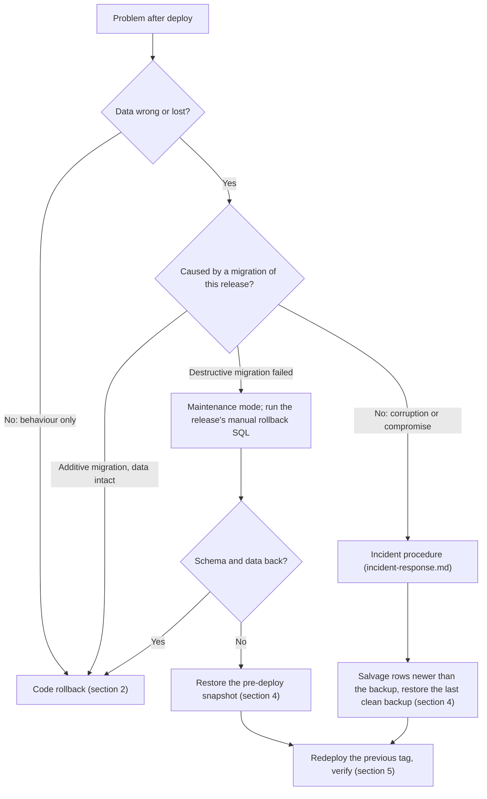

# Rollback

Sources: Doc 09 TRD §6.5 (expand–contract) and §6.8, Doc 12 §8.3, `Kernel\Migration\Runner`. Backups and the
restore procedure: [backup-restore.md](backup-restore.md).

## 1. Ground rules

- **Migrations are forward-only.** `Kernel\Migration\Runner` has no "down" step: every migration (`M0001…`, module
  ranges in docs/ENGINEERING.md §3) is idempotent and additive, and the applied IDs are recorded in the option `momos_migrations`. A code
  rollback therefore runs the previous release **against the newer schema**. This is safe because schema changes follow
  expand–contract: new columns are nullable/defaulted, new tables and indexes are ignored by older code, and removals
  happen one release later (TRD §6.5). A release that breaks this rule needs CTO sign-off, a fresh backup and written
  manual rollback SQL in its release notes *before* it is deployed.
- Never "undo" a migration by deleting its ID from the `momos_migrations` option: `wp momos migrate` would re-run it.
- Never restore the database to fix a code defect. Data restore is for data corruption, a failed destructive migration
  or a compromise only — it discards every reservation made after the backup point.

## 2. Code rollback (target ≤ 15 min)

1. Decide: QA lead + tech lead (+ Owner during the launch cutover, Doc 12 §8.3).
2. Re-point the symlinks (`mu-plugins`, `plugins/momos-core`, `themes/momos`) to `releases/<previous-tag>/`; restore the
   previous `server/*.conf` if they changed (`nginx -t && systemctl reload nginx`).
3. `wp momos jobs sync` (job definitions may differ); do **not** run `wp momos migrate` (it would report nothing to do —
   the newer schema stays).
4. `wp cache flush`; `wp momos cache purge --all`; CDN purge.
5. Verify (§5). Record the rollback (tags, time, reason) and open a defect.

If `wp momos smoke` on the previous release reports a missing table/constraint, the newer release did a non-additive
change: continue with §3.

## 3. Database decision tree



## 4. Restoring the database (target RTO ≤ 8 h, RPO ≤ 4 h)

1. `wp maintenance-mode activate`; comment out the cron line (pauses jobs and the notification queue).
2. **Salvage** what the backup does not contain, while the damaged database is still readable. There is no
   `wp momos salvage` command in this build (TRD §6.8 names one; not implemented), so export by timestamp with the
   database tools, `T` = the backup's `created_utc` from its `MANIFEST` (UTC, as stored):

   ```bash
   P=<table prefix>; T='2026-11-19 10:16:32'
   mysqldump --no-create-info --replace --single-transaction <db> ${P}momo_reservations --where="updated_at >= '$T'" > salvage-reservations.sql
   mysqldump --no-create-info --insert-ignore --single-transaction <db> ${P}momo_reservation_events --where="created_at >= '$T'" > salvage-events.sql
   mysqldump --no-create-info --insert-ignore --single-transaction <db> ${P}momo_notifications --where="created_at >= '$T'" > salvage-notifications.sql
   ```
   These files contain personal data: keep them in the private backup directory (mode 600) and delete them after the
   incident. Skip salvage when the newer rows themselves are suspect (compromise).
3. Restore the pre-deploy snapshot or last clean backup: `bin/restore.sh <dir|file.tar.gpg> --yes`
   ([backup-restore.md](backup-restore.md) §4); restore to staging first when integrity is in doubt.
4. Re-import the salvage files (same IDs and references; duplicates skipped/replaced) with `wp db query < file` —
   the mysqldump header disables FK checks, so `REPLACE` of a reservation keeps its events (rehearsed on a copy of the
   seeded database: the updated row replaced, its event rows unchanged) — then
   `wp momos audit verify`. Salvaged audit rows are not re-imported (the chain would break); the incident record notes
   the gap.
5. Deploy the previous tag if the newer code needs the newer schema; `wp momos jobs sync`.
6. Review queued notifications before cron is switched back on ([backup-restore.md](backup-restore.md) §4 step 5).

## 5. Verification after any rollback

- `wp momos smoke` → `Success: Smoke checks passed.`; `wp momos jobs list` shows no `late` job after 10 minutes.
- `wp momos audit verify` → `Success: N rows verified.`
- HTTP checks of [deployment.md](deployment.md) §5 step 11 (home in every enabled language, branch, dish, API-01, deny
  rules, one 301 from http).
- TEST-branch reservation smoke (Doc 12 §8.5): submit → staff accept → E02 in the QA inbox.
- Reservation counts per branch for today and tomorrow match the staff inbox and the branch notification emails.
- `wp maintenance-mode deactivate`, cron line back on, HO informed.
